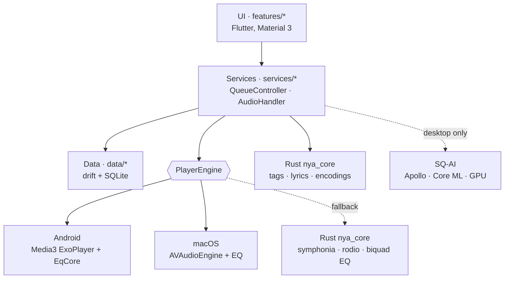

<div align="center">


# NyaPlayer

**A purely local, offline Material 3 music player — no ads, no account, no network.**

[](#-200)
[](#-platforms)
[](#-platforms)
[](#-privacy)
[](LICENSE)

[**English**](README.md) · [简体中文](README.zh-CN.md)

<br/>


<sub>Screenshots use the built-in fictional demo library.</sub>

</div>

---

## 🆕 2.0.0

The first release that plays through each platform's own audio stack, and the first with AI super-resolution.

- **Platform-native playback** — Android on Media3 ExoPlayer, macOS on AVAudioEngine. The Rust core stays as an optional fallback.
- **15-band equalizer** with 23 presets on both platforms; Hi-Res tracks bypass it to stay bit-faithful.
- **SQ-AI** (macOS) — turn MP3s into 16-bit / 44.1 kHz FLAC with the Apollo model on the GPU.
- **Quality badges** — gold **Hi-Res**, silver-black **SQ**, tech-blue **SQ-AI**.
- **macOS desktop widgets**, hero cover transition, a full open-source licence page.
- The version shown in Settings now includes the platform and CPU architecture, e.g. `2.0.0-Android(armv8a)` or `2.0.0-macOS(arm64)`.

## 📸 Screenshots

<table>
  <tr>
    <td width="50%"></td>
    <td width="50%"></td>
  </tr>
  <tr>
    <td align="center"><sub>Fullscreen player · bilingual lyrics · blurred cover backdrop</sub></td>
    <td align="center"><sub>Albums · spinning-disc cover · quality badge</sub></td>
  </tr>
</table>

## ✨ Features

| | |
|---|---|
| 🎵 **Playback** | FLAC (incl. 24‑bit / hi‑res) and MP3 with gapless playback, decoded by the platform itself: Media3 ExoPlayer on Android, AVAudioEngine on macOS |
| 📚 **Library** | Scans your music folders; browse by songs, albums, artists, folders; playlists, favourites, full‑text search, exclude folders, hide very short tracks |
| 🖼️ **Cover art & lyrics** | Embedded artwork and lyrics or `.lrc` files (UTF‑8, GBK, Shift‑JIS), scrolling highlight, tap‑to‑seek, bilingual lines (original + translation) |
| 🏅 **Quality badges** | Real format and sample rate on every track, each badge with a one‑off sweep of light (see below) |
| ✨ **AI super‑resolution (desktop only)** | Pick MP3s from your library in Settings and turn them into 16‑bit / 44.1 kHz FLAC with the Apollo model on the GPU (Core ML on macOS), about 2.4× real time. On phones and tablets the setting is shown but switched off. The MP3 stays; the new file is saved beside it as `name.SQ-AI.flac` with tags, lyrics and cover copied over. It is generated sound, not the original recording |
| 🎨 **Material 3 design** | Light / dark, wallpaper‑based dynamic colour, blurred cover backdrop with coloured light, square / spinning‑disc / turntable covers, several progress‑bar styles, adaptive layouts for phone, tablet, foldable and desktop |
| 📱 **System integration** | Background playback, media notification (shows in Samsung's media capsule), lock‑screen / headset / media‑key control, audio focus; macOS menu‑bar menu and desktop widgets |
| 🎚️ **15‑band equalizer** | 25 Hz – 16 kHz (⅔ octave), ±12 dB, 23 built‑in presets plus your own, off by default; Hi‑Res tracks bypass it automatically |
| 🌍 **Languages** | English, 简体中文, 繁體中文, 日本語, 한국어, Deutsch, Español, Français, Русский |
| 🔒 **Privacy first** | No network requests, no data collection, your library never leaves the device |

<sub>**Not doing:** streaming, online scraping, tag editing, video, audiophile bit‑perfect output, accounts and cloud sync.</sub>

### 🏅 Quality badges

| Badge | Meaning |
|:--|:--|
|  | Hi‑Res lossless. Goes around the equalizer untouched. |
|  | Standard lossless FLAC. |
|  | FLAC generated from an MP3 by the on‑device Apollo model. |

## 🖥️ Platforms

| Platform | Minimum | Architecture | Status |
|:--|:--|:--|:--|
| 🤖 **Android** | Android 12 (API 31) | ARMv8‑A (`arm64-v8a`) | ✅ 2.0.0 · primary platform |
| 🍎 **macOS** | macOS 15 Sequoia | Apple Silicon · Intel | ✅ 2.0.0 (Apple Silicon tested; the Intel build compiles but has not been run) |
| 🍏 **iOS** | iOS 18 | arm64 | 🎯 First in line |
| 🪟 **Windows** | Windows 10 | x64 · arm64 | 🛠️ Secondary (planned) |
| 🐧 **Linux** | Ubuntu 22.04 | x64 · aarch64 | 🛠️ Secondary (planned) |

> HarmonyOS is not planned.
> Developer-side difficulty and priorities live in [`docs/PLATFORM_SUPPORT.md`](docs/PLATFORM_SUPPORT.md) (Chinese).

## 🧱 Tech stack

<div align="center">

[](https://flutter.dev)
[](https://dart.dev)
[](https://m3.material.io)
[](https://www.rust-lang.org)
[](https://kotlinlang.org)
[](https://www.swift.org)
[](python/)

[](docs/TECH_SPEC.md)
[](docs/TECH_SPEC.md)
[](docs/TECH_SPEC.md)
[](https://github.com/fzyzcjy/flutter_rust_bridge)
[](https://riverpod.dev)
[](https://drift.simonbinder.eu)
[](https://github.com/Serial-ATA/lofty-rs)

</div>

| Layer | Choice |
|---|---|
| UI | Flutter (stable) · Dart 3 · Material 3 |
| Playback — Android | Media3 ExoPlayer 1.11, using the device's own decoders; 15‑band EQ as an `AudioProcessor` (Kotlin) |
| Playback — macOS | `AVAudioEngine` + `AVAudioPlayerNode` + `AVAudioUnitEQ` (Swift) |
| AI super‑resolution | Apollo (PyTorch → Core ML FP16), STFT with Accelerate, GPU inference, 16‑bit FLAC via `ExtAudioFile` — macOS only |
| Rust core `nya_core` | Tags and lyrics (`lofty`), legacy‑encoding repair (`encoding_rs`), and the optional Rust playback core (`symphonia` decode, `rodio`/`cpal` output, biquad EQ) |
| Bridge | [`flutter_rust_bridge`](https://github.com/fzyzcjy/flutter_rust_bridge) 2.13 (built via Cargokit) |
| System controls | `audio_service` · `audio_session` |
| State / routing | `flutter_riverpod` · `go_router` |
| Storage | `drift` on SQLite (FTS5 search) |
| Theming | `dynamic_color` |

### Architecture



The UI controls playback only through `AudioHandler` / `QueueController`; every audio core sits behind the `PlayerEngine` interface (`PlatformPlayerEngine` for Media3 and AVAudioEngine, `RustPlayerEngine` as the fallback). See [`TECH_SPEC`](docs/TECH_SPEC.md).

## 🚧 Known limitations

- **Android is `arm64-v8a` only**, and release builds are signed with the debug key for now.
- **macOS gapless:** two files with different sample rates or channel counts are joined with a very short gap, because the audio graph has to be rebuilt between them.
- **Android renders with Skia**, not Impeller (see below). Re‑check the `EnableImpeller` flag in `AndroidManifest.xml` whenever Flutter is upgraded.
- **AI super‑resolution is desktop only** (today that means macOS). It runs on the GPU through Core ML, with no CPU fallback, and a conversion briefly needs about 2 GB (released a few seconds after it ends). The model is built from `python/` and bundled by `tool/build_release.py` (not in git). It is Apollo (CC BY‑SA 4.0). An Android version was tried and dropped: the model needed about 10 GB of memory on a phone, so on mobile the setting is disabled.
- **Memory:** the macOS app sits around 300–400 MB, mostly graphics memory for the blur and light effects; it does not grow while idle.
- Deliberately left out (this is a personal‑use player): Android home‑screen widget, sleep timer, playback speed, ReplayGain, M3U import/export, smart lists.

## ⚡ Performance notes

Measured on a Galaxy S23‑class phone (Snapdragon 8 Gen 2, Android 15), release build:

- Frantically scrolling the lyrics costs about **one eighth** of the GPU work it did at first (GPU busy × clock: 543 → 65), at steady 8.3 ms frames.
- Playing a song with the player page open uses roughly **1–6 %** of one CPU core.
- On Android, Skia drew the same screens with about a third of the GPU work Impeller needed. The static backdrop is painted once and cached, and nothing animates forever while a song plays.

Method, numbers and the dead ends are in [`docs/PROGRESS.md`](docs/PROGRESS.md).

## 🚀 Getting started

**Prerequisites:** Flutter stable (Dart ≥ 3.13), Rust stable via [`rustup`](https://rustup.rs), and the toolchain for your target platform (Xcode, Android SDK + NDK, …).

```bash
git clone git@github.com:Kazuma-Kobayashi01/NyaPlayer.git && cd NyaPlayer
flutter pub get

# Run
flutter run -d macos
flutter run --release -d <android-device-id>

# Checks before committing
dart format . && flutter analyze && flutter test
cargo test --manifest-path rust/Cargo.toml

# Release builds
python3 tool/build_release.py
# output/darwin-arm64/NyaPlayer.app
# output/darwin-x86_64/NyaPlayer.app
# output/android-armv8a/NyaPlayer.apk
```

**Installing a build**

- **Android:** sideload `output/android-armv8a/NyaPlayer.apk` and grant the audio permission when asked.
- **macOS:** copy the `.app` that matches your Mac to Applications. It is ad‑hoc signed, so on first launch right‑click → Open (or clear the quarantine flag with `xattr -dr com.apple.quarantine`).

> Flutter desktop cannot cross-compile between operating systems: build Windows on Windows and Linux on Linux (or in CI).
> More on build outputs in [`docs/BUILD_OUTPUTS.md`](docs/BUILD_OUTPUTS.md).

## 📚 Documentation

The documents are in Chinese.

| Document | What it covers |
|---|---|
| [`REQUIREMENTS`](docs/REQUIREMENTS.md) | What the app must do: numbered, prioritised requirements, MVP and acceptance |
| [`TECH_SPEC`](docs/TECH_SPEC.md) | Technical rules: dependencies, architecture, playback engines, EQ, platform setup, data design |
| [`PLATFORM_SUPPORT`](docs/PLATFORM_SUPPORT.md) | Platform baselines, porting difficulty and priority |
| [`BUILD_OUTPUTS`](docs/BUILD_OUTPUTS.md) | How release builds are produced and checked |
| [`DESKTOP_WIDGETS`](docs/DESKTOP_WIDGETS.md) | Desktop widget design limits and the native route |
| [`PLAN`](docs/PLAN.md) | Milestones and task list |
| [`PROGRESS`](docs/PROGRESS.md) | Build log: decisions, measurements, pitfalls |

## 🔒 Privacy

NyaPlayer makes no network requests and collects no data. Library data and the cover cache stay on your device.

## Credits

- **Authors:** Kazuma‑Kobayashi01 (lead author, maintainer) · Claude (AI-assisted development) · Codex (AI-assisted development)
- **AI super‑resolution model:** [Apollo](https://github.com/JusperLee/Apollo), CC BY‑SA 4.0.
- **Fonts:** HarmonyOS Sans SC (© Huawei Device Co., Ltd.), EB Garamond and Noto Serif SC (SIL OFL). Full list on the licence page inside the app.

## 📄 License

Released under the [MIT License](LICENSE).
