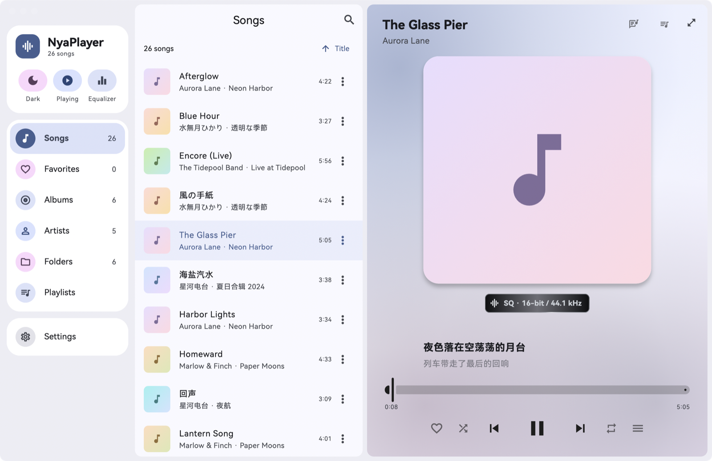
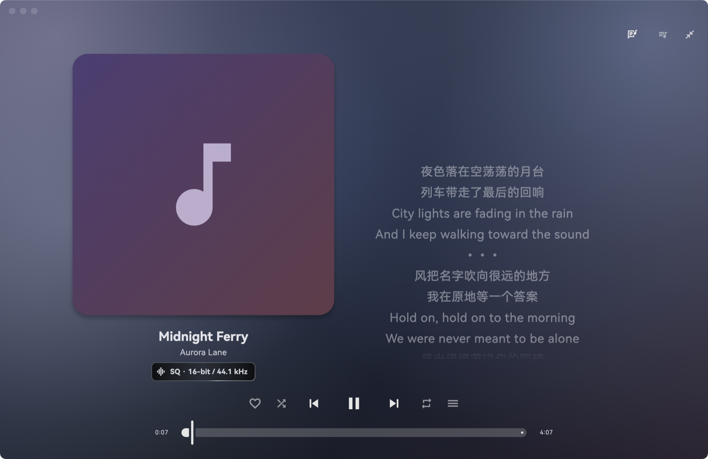
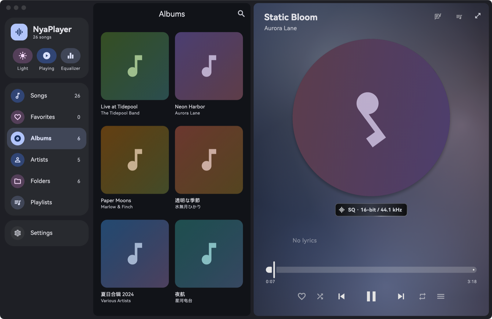
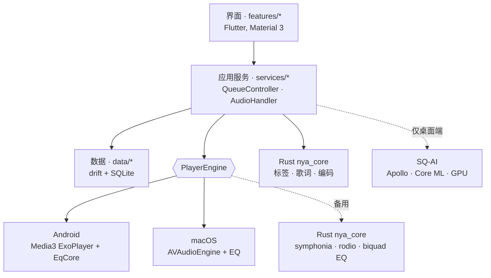

<div align="center">


# NyaPlayer

**纯本地、离线的 Material 3 音乐播放器 —— 无广告 · 无账号 · 无联网 · 只有你的音乐**

[](#-200)
[](#-支持平台)
[](#-支持平台)
[](#-隐私)
[](LICENSE)

[English](README.md) · **简体中文**

<br/>



<sub>截图使用内置的虚构演示曲库。</sub>

</div>

---

## 🆕 2.0.0

第一个全面使用各平台自带音频内核的版本，也是第一个带 AI 超分的版本。

- **平台原生播放内核** —— Android 用 Media3 ExoPlayer，macOS 用 AVAudioEngine；Rust 内核作为可选的备用内核保留。
- **15 段均衡器**与 23 个预设，两个平台都有；Hi‑Res 歌曲绕过均衡器，保持原样。
- **SQ‑AI**（macOS）—— 用 GPU 上的 Apollo 模型把 MP3 转成 16‑bit / 44.1 kHz FLAC。
- **音质徽章** —— 金色 **Hi‑Res**、银黑色 **SQ**、科技蓝 **SQ‑AI**。
- **macOS 桌面小组件**、封面共享元素过渡、完整的开源许可证页。
- 设置里的版本号现在带平台与 CPU 架构，例如 `2.0.0-Android(armv8a)`、`2.0.0-macOS(arm64)`。

## 📸 截图

<table>
  <tr>
    <td width="50%"></td>
    <td width="50%"></td>
  </tr>
  <tr>
    <td align="center"><sub>全屏播放器 · 双语歌词 · 封面模糊背景</sub></td>
    <td align="center"><sub>专辑 · 旋转圆盘封面 · 音质徽章</sub></td>
  </tr>
</table>

## ✨ 特性

| | |
|---|---|
| 🎵 **播放** | FLAC（含 24bit / 高采样率）与 MP3，支持无缝播放，由系统自带的解码器处理：Android 用 Media3 ExoPlayer，macOS 用 AVAudioEngine |
| 📚 **曲库** | 扫描你的音乐文件夹；按歌曲、专辑、艺术家、文件夹浏览；歌单、收藏、全文搜索、排除文件夹、隐藏过短的曲目 |
| 🖼️ **封面与歌词** | 读取内嵌封面与歌词，也支持 `.lrc` 文件（UTF‑8、GBK、Shift‑JIS），滚动高亮、点击跳转、双语（原文 + 翻译）歌词 |
| 🏅 **音质徽章** | 每首歌显示真实的格式与采样率，徽章出现时各有一次扫光（见下） |
| ✨ **AI 超分（仅桌面端）** | 在设置里从曲库选 MP3，用 GPU 上的 Apollo 模型（macOS 上走 Core ML）转成 16‑bit / 44.1 kHz FLAC，约 2.4 倍实时。手机和平板上这一项照常显示，但置灰禁用。原 MP3 保留，新文件保存在旁边，名为 `名称.SQ-AI.flac`，标签、歌词、封面一并带过去。补出来的是生成的声音，不是原始录音 |
| 🎨 **Material 3 界面** | 浅色 / 深色、壁纸动态取色、带彩色光斑的封面模糊背景，方形 / 旋转圆盘 / 唱机三种封面，多种进度条样式，手机、平板、折叠屏、桌面自适应布局 |
| 📱 **系统集成** | 后台播放、媒体通知（可在三星的媒体胶囊中显示）、锁屏 / 耳机 / 媒体键控制、音频焦点；macOS 菜单栏菜单与桌面小组件 |
| 🎚️ **15 段均衡器** | 25 Hz – 16 kHz（⅔ 倍频程），±12 dB，23 个内置预设与自定义预设，默认关闭；Hi‑Res 歌曲自动绕过均衡器 |
| 🌍 **语言** | English、简体中文、繁體中文、日本語、한국어、Deutsch、Español、Français、Русский |
| 🔒 **隐私优先** | 不发起任何网络请求，不收集任何数据，曲库永远留在你的设备上 |

<sub>**不做：** 流媒体、在线刮削、标签编辑、视频、发烧级 bit‑perfect 输出、账号与云同步。</sub>

### 🏅 音质徽章

| 徽章 | 含义 |
|:--|:--|
|  | Hi‑Res 无损，直接绕过均衡器。 |
|  | 普通无损 FLAC。 |
|  | 由设备上的 Apollo 模型从 MP3 生成的 FLAC。 |

## 🖥️ 支持平台

| 平台 | 最低版本 | 架构 | 状态 |
|:--|:--|:--|:--|
| 🤖 **Android** | Android 12（API 31） | ARMv8‑A（`arm64-v8a`） | ✅ 2.0.0 · 主平台 |
| 🍎 **macOS** | macOS 15 Sequoia | Apple Silicon · Intel | ✅ 2.0.0（Apple Silicon 已测试；Intel 版能构建，尚未实际运行） |
| 🍏 **iOS** | iOS 18 | arm64 | 🎯 优先适配（下一个） |
| 🪟 **Windows** | Windows 10 | x64 · arm64 | 🛠️ 次级适配（计划中） |
| 🐧 **Linux** | Ubuntu 22.04 | x64 · aarch64 | 🛠️ 次级适配（计划中） |

> 不计划适配 HarmonyOS。
> 适配难度与优先级见 [`docs/PLATFORM_SUPPORT.md`](docs/PLATFORM_SUPPORT.md)。

## 🧱 技术栈

<div align="center">

[](https://flutter.dev)
[](https://dart.dev)
[](https://m3.material.io)
[](https://www.rust-lang.org)
[](https://kotlinlang.org)
[](https://www.swift.org)
[](python/)

[](docs/TECH_SPEC.md)
[](docs/TECH_SPEC.md)
[](docs/TECH_SPEC.md)
[](https://github.com/fzyzcjy/flutter_rust_bridge)
[](https://riverpod.dev)
[](https://drift.simonbinder.eu)
[](https://github.com/Serial-ATA/lofty-rs)

</div>

| 层 | 方案 |
|---|---|
| 界面 | Flutter（stable）· Dart 3 · Material 3 |
| 播放 — Android | Media3 ExoPlayer 1.11，使用设备自带的解码器；15 段均衡器做成 `AudioProcessor`（Kotlin） |
| 播放 — macOS | `AVAudioEngine` + `AVAudioPlayerNode` + `AVAudioUnitEQ`（Swift） |
| AI 超分 | Apollo（PyTorch → Core ML FP16），STFT 用 Accelerate，GPU 推理，`ExtAudioFile` 写 16‑bit FLAC —— 仅 macOS |
| Rust 内核 `nya_core` | 标签与歌词（`lofty`）、旧编码修复（`encoding_rs`），以及可选的 Rust 播放内核（`symphonia` 解码、`rodio`/`cpal` 输出、biquad 均衡器） |
| 桥接 | [`flutter_rust_bridge`](https://github.com/fzyzcjy/flutter_rust_bridge) 2.13（经 Cargokit 构建） |
| 系统控制 | `audio_service` · `audio_session` |
| 状态管理 / 路由 | `flutter_riverpod` · `go_router` |
| 存储 | `drift` + SQLite（FTS5 搜索） |
| 主题 | `dynamic_color` |

### 架构



UI 只通过 `AudioHandler` / `QueueController` 控制播放，所有音频内核都由 `PlayerEngine` 接口隔离（Media3 与 AVAudioEngine 共用 `PlatformPlayerEngine`，`RustPlayerEngine` 作为备用）。详见 [`TECH_SPEC`](docs/TECH_SPEC.md)。

## 🚧 已知限制

- **Android 只支持 `arm64-v8a`**，release 包目前用 debug 签名。
- **macOS 无缝播放：** 相邻两首采样率或声道数不同时，需要重建音频图，两首之间会有一个很短的间隙。
- **Android 使用 Skia 渲染**，而不是 Impeller（见下）。升级 Flutter 时需重新核对 `AndroidManifest.xml` 里的 `EnableImpeller` 开关。
- **AI 超分仅限桌面端**（目前就是 macOS）：通过 Core ML 在 GPU 上跑，没有 CPU 兜底，一次转换会短暂用到约 2 GB（结束几秒后释放）；模型由 `python/` 构建、`tool/build_release.py` 打进安装包，不在 git 里；用的是 Apollo（CC BY‑SA 4.0）。Android 版试过后放弃了：模型在手机上要约 10 GB 内存，所以移动端这一项是禁用的。
- **内存：** macOS 版常驻约 300–400 MB，大部分是模糊与光斑效果占用的图形内存，空闲时不会增长。
- 有意不做（这是自用播放器）：Android 桌面小组件、睡眠定时、倍速、ReplayGain、M3U 导入导出、智能列表。

## ⚡ 性能说明

在一台三星 S23 级别的手机（骁龙 8 Gen 2，Android 15）上，release 构建的实测：

- 持续疯狂滑动歌词时，GPU 工作量约为最初的 **八分之一**（忙碌度 × 频率：543 → 65），帧间隔稳定在 8.3 ms。
- 播放歌曲并打开播放页时，约占一个 CPU 核心的 **1–6 %**。
- 在 Android 上，Skia 画同样的界面只需要 Impeller 约三分之一的 GPU 工作量；静态背景只绘制一次并缓存，播放期间没有永不停歇的动画。

方法、数据和走过的弯路见 [`docs/PROGRESS.md`](docs/PROGRESS.md)。

## 🚀 快速开始

**前置条件：** Flutter stable（Dart ≥ 3.13）、通过 [`rustup`](https://rustup.rs) 安装的 Rust stable，以及目标平台的工具链（Xcode、Android SDK + NDK 等）。

```bash
git clone git@github.com:Kazuma-Kobayashi01/NyaPlayer.git && cd NyaPlayer
flutter pub get

# 运行
flutter run -d macos
flutter run --release -d <android-device-id>

# 提交前检查
dart format . && flutter analyze && flutter test
cargo test --manifest-path rust/Cargo.toml

# 发布构建
python3 tool/build_release.py
# output/darwin-arm64/NyaPlayer.app
# output/darwin-x86_64/NyaPlayer.app
# output/android-armv8a/NyaPlayer.apk
```

**安装构建产物**

- **Android：** 侧载 `output/android-armv8a/NyaPlayer.apk`，按提示授予音频权限。
- **macOS：** 把适合你这台 Mac 的 `.app` 复制到“应用程序”。它是 ad‑hoc 签名，首次打开请右键 →“打开”（或用 `xattr -dr com.apple.quarantine` 清除隔离标记）。

> Flutter 桌面端不支持跨操作系统交叉编译：Windows 版需在 Windows 上构建，Linux 版需在 Linux 上构建（或使用 CI）。
> 构建产物的更多说明见 [`docs/BUILD_OUTPUTS.md`](docs/BUILD_OUTPUTS.md)。

## 📚 文档

| 文档 | 内容 |
|---|---|
| [`REQUIREMENTS`](docs/REQUIREMENTS.md) | 需求声明：带编号与优先级的功能需求、MVP 与验收标准 |
| [`TECH_SPEC`](docs/TECH_SPEC.md) | 技术要求：依赖、架构、播放引擎、EQ、平台配置、数据设计 |
| [`PLATFORM_SUPPORT`](docs/PLATFORM_SUPPORT.md) | 平台基线、适配难度与优先级 |
| [`BUILD_OUTPUTS`](docs/BUILD_OUTPUTS.md) | Release 构建如何产出与校验 |
| [`DESKTOP_WIDGETS`](docs/DESKTOP_WIDGETS.md) | 桌面小组件的设计边界与原生路线 |
| [`PLAN`](docs/PLAN.md) | 里程碑与任务清单 |
| [`PROGRESS`](docs/PROGRESS.md) | 施工记录：决定、实测数据、踩过的坑 |

## 🔒 隐私

NyaPlayer 不发起任何网络请求，也不收集任何数据。曲库数据与封面缓存仅保存在本地。

## 致谢

- **作者：** Kazuma‑Kobayashi01（第一作者、项目维护者）· Claude（AI 辅助开发）· Codex（AI 辅助开发）
- **AI 超分模型：** [Apollo](https://github.com/JusperLee/Apollo)，CC BY‑SA 4.0。
- **字体：** HarmonyOS Sans SC（© Huawei Device Co., Ltd.）、EB Garamond 与 Noto Serif SC（SIL OFL）。完整清单见应用内许可证页。

## 📄 许可证

采用 [MIT 许可证](LICENSE)。
